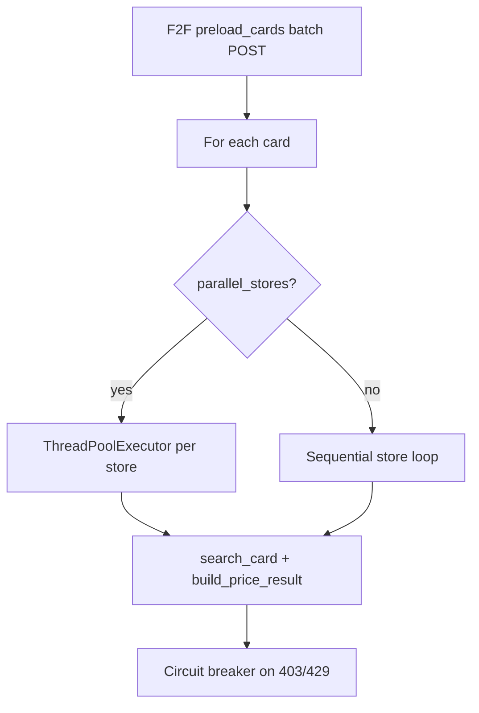

# AGENTS.md

## Project Overview

MTG Price Checker is a terminal-based Python application that compares Magic: The Gathering card prices across multiple Canadian game stores.

Input:

- A text file containing card names (one per line)

Output:

- A CSV price matrix:

  - rows = cards
  - columns = stores
  - cell = lowest Near Mint in-stock CAD price OR status indicator

- An optional audit CSV (only when `--audit` is set) with debugging and traceability details:

  - status
  - chosen product URL
  - notes/errors

The project is intentionally modular so new stores can be added independently.

---

# Input File Format

Parsed by `input/decklist_parser.py`:

- One card per line
- Optional quantity prefix: `4 Sol Ring` (quantity is parsed but **not used** in pricing today)
- Lines starting with `#` are treated as comments and ignored
- Encodings tried in order: `utf-8-sig`, `utf-8`, `utf-16`

---

# Output Format

Written by `output/csv_writer.py`:

**Price matrix cells:**

- `FOUND` → `$X.XX`
- `NOT_FOUND` / `OUT_OF_STOCK` → status string
- `ERROR` → `ERROR: {notes}`

**Audit CSV:**

- Optional; requires `--audit path/to/audit.csv`
- One row per card/store with status, price, product URL, and notes

---

# Current Supported Stores

Implemented:

- Danireon
- Silver Goblin
- Face to Face Games
- `demo` — offline fake Face to Face + Danireon adapters (Sol Ring / Arcane Signet only; no HTTP)

Planned:

- Imaginaire (milestone 5 — `milestone-5-imaginaire` branch)

---

# High-Level Architecture

```text
src/mtg_price_checker/
├── cli.py
├── domain/
├── stores/
│   ├── danireon.py
│   ├── silvergoblin.py
│   ├── facetoface.py
│   ├── shopify_common.py
│   └── fake.py
├── services/
│   ├── price_checker.py
│   └── store_registry.py
├── infra/
│   ├── http_client.py
│   └── browser_http_client.py
├── input/
│   └── decklist_parser.py
├── output/
│   └── csv_writer.py
└── tests/

scripts/
└── debug_http_status.py
```

## Important Modules

### `stores/`

Contains one adapter per store.

Each store has completely custom parsing logic because every website behaves differently.

Current adapters:

- `danireon.py`
- `silvergoblin.py`
- `facetoface.py`
- `shopify_common.py` (shared Shopify JSON helpers)
- `fake.py` (demo/offline adapters)

### `services/price_checker.py`

Shared orchestration logic:

- batch preload for `BatchStoreAdapter` stores (Face to Face) before the card loop
- per-card store queries (sequential or parallel via `ThreadPoolExecutor`)
- selects lowest valid NM in-stock quote (respects `finish_preference`)
- handles statuses and audit notes (`Checked N product listings.`)
- store circuit-breaker logic (403/429 disables store for remainder of run)
- thread-safe circuit breaker when `--parallel-stores` is active
- progress logging to stderr for lists over 20 cards: `[i/N] Card — Store STATUS, ...`



### `services/store_registry.py`

Store wiring via `build_stores()`:

- each real store adapter gets its **own** `HttpClient` or `BrowserHttpClient` instance (separate session and rate-limit clock)
- all clients share the same disk cache directory (`.cache/http`, keyed by URL hash)
- `--use-browser` applies to Danireon and Silver Goblin only; Face to Face always uses plain `HttpClient`
- per-store default max products: Danireon 12, Silver Goblin 12, Face to Face 5

Supported store IDs and aliases:

- `danireon`
- `silvergoblin`, `silver-goblin`, `silver_goblin`
- `facetoface`, `face-to-face`, `face_to_face`, `f2f`
- `demo`

### `infra/http_client.py`

Shared HTTP infrastructure:

- request delay (`min_seconds_between_requests`)
- disk caching (GET and POST)
- 429 retry with `Retry-After` or 45s backoff (up to 2 retries)
- GET text / GET JSON / POST JSON helpers (via shared `requests.Session`)
- per-host session warmup (homepage visit before first request)
- browser navigation headers (`Referer`, `Sec-Fetch-*`)
- optional cookies file import

### `infra/browser_http_client.py`

Playwright-backed HTTP client for Shopify stores when `--use-browser` is set:

- no disk cache
- no `min_seconds_between_requests` throttling
- requires `pip install mtg-price-checker[browser]` and `playwright install chromium`

### `domain/`

Shared domain models:

- `RequestedCard` (includes `finish_preference`, default `EITHER`)
- `StoreQuote`
- `PriceResult`
- enums for condition, finish, result status

---

# Core Business Rules

## Valid Quote Selection

The app only considers:

- Near Mint (`NM`)
- in-stock
- CAD prices
- finish matching `RequestedCard.finish_preference` (default: either foil or nonfoil)

The final selected result per store/card is:

- lowest valid NM in-stock price

## Product Discovery — No Price-Sorted Search

**Never sort search results by price.** Stores mix TCGs; cheap wrong-game products can rank first if sorted by price.

Safe pipeline:

1. Discover product URLs in relevance order (suggest + HTML search merge)
2. Fetch up to N candidate product pages
3. Exact card name match filters wrong-TCG hits
4. Choose lowest NM in-stock quote among valid matches

## Status Semantics

### `FOUND`

At least one valid NM in-stock quote exists.

### `OUT_OF_STOCK`

Card exists at the store but no valid NM in-stock quote exists.

### `NOT_FOUND`

No matching product/card found.

### `ERROR`

HTTP errors, parsing failures, unexpected response shapes, etc.

---

# Current Store Implementations

# Danireon

Strategy (JSON-first):

1. Search via Shopify Predictive Search:
   `/search/suggest.json?q=...&resources[type]=product&resources[limit]=10&resources[limit_scope]=each`
2. Also fetch full HTML search page and merge product URLs (relevance order, no price sort)
3. Parse product URLs from JSON (never skip HTML search when suggest returns results)
4. Fetch product details via `/products/{handle}.js` for up to N candidates
5. Parse condition/price/inventory from variant JSON (HTML product page fallback)

Notes:

- Uses shared helpers in `shopify_common.py`
- Session warmup + browser-like headers reduce 403 rate limits
- Default max product detail fetches per card: 12
- Exact card name match filters wrong-TCG search hits before price comparison

---

# Silver Goblin

Strategy (JSON-first):

1. Search via `/search/suggest.json` plus full HTML search merge (relevance order, no price sort)
2. Fetch `/products/{handle}.js` for up to N candidate products
3. Parse variants for condition, price, inventory
4. HTML product page fallback only for non-403/429 parse failures

Notes:

- Uses shared helpers in `shopify_common.py`
- Default max product detail fetches per card: 12
- Exact card name match filters wrong-TCG search hits before price comparison

---

# Face to Face Games

IMPORTANT:
The **primary** path uses the Deck Builder JSON endpoint, not HTML search scraping.

## Primary Path — Deck Builder Batch POST

### Endpoint

```text
POST https://facetofacegames.com/apps/prod-indexer/deckBuilder/search
```

### Payload Shape

```json
{
  "sort": false,
  "filters": [
    {
      "field": "Card Name",
      "values": ["Sol Ring", "Arcane Signet"]
    },
    {
      "field": "in_stock",
      "values": ["1"]
    }
  ]
}
```

### Response Shape

Useful data is under:

```json
{
  "Cards": {
    "Sol Ring": [...],
    "Arcane Signet": [...]
  }
}
```

Each product entry contains:

- `_source.handle`
- `_source.General_Card_Name`
- `_source.MTG_Set_Name`
- `_source.MTG_Collector_Number`
- `_source.MTG_Foil_Option`
- `_source.variants`

Each variant contains:

- `price`
- `inventoryQuantity`
- `selectedOptions`

Condition is found in:

- `selectedOptions`
- option name `"Condition"`

### Batch Preload Architecture

Face to Face supports batch loading.

It should:

- make ONE POST request for the full card list
- preload all results
- store quotes internally
- parse **all** in-stock printings returned for each card (no pre-price truncation)

`search_card()` should:

- read from preloaded data
- not make one POST per card during normal runs

This is implemented via:

- `BatchStoreAdapter` protocol and `preload_cards()` call before card/store loops

This dramatically improves:

- speed
- request count
- reliability

## Fallback Path — HTML Search

If batch preload fails (except HTTP 429, which is re-raised):

1. HTML search page `/search?q=...&type=product`
2. Up to N product detail pages (default 5)
3. Parse condition/price from product HTML

This fallback exists in `facetoface.py` but should not be the normal code path.

---

# HTTP Infrastructure

## Shared HttpClient Features

Features:

- request delay between live (uncached) requests
- disk caching for GET and POST responses
- 429 retry: up to 2 retries, honoring `Retry-After` header or 45s backoff
- GET text / GET JSON / POST JSON helpers
- per-host session warmup
- browser navigation headers
- optional cookies file import

Note: 429 retry is distinct from the circuit breaker. Retries happen within a single request; the circuit breaker disables the entire store for the run after a 403 or 429 propagates as an error.

## Cache

Cache entries currently expire after:

- 24 hours (configurable via `--cache-ttl-hours`)

Reason:
Store inventory updates daily.

Cache directory: `.cache/http` (URL-hash filenames, shared across all store HttpClient instances).

Cache hits skip both network requests and request-delay sleeps.

## Request Delay

The app intentionally spaces live HTTP requests to avoid hammering stores.

CLI tuning options exist for:

- request delay
- max products per card

---

# Important Reliability Features

# Store Circuit Breaker

The app disables stores during a run after:

- HTTP 403
- HTTP 429

Reason:
Avoid repeatedly hammering a blocked/rate-limited store.

Behavior:

- first 403/429:

  - current request becomes ERROR
  - store disabled for remainder of run
- subsequent cards:

  - store is skipped
  - ERROR returned immediately

Other stores continue normally.

In parallel mode, circuit-breaker state updates are protected by a thread lock.

---

# HTTP Headers and Session Behavior

The shared HttpClient uses browser-like headers:

- User-Agent
- Accept
- Accept-Language
- Sec-Fetch-* navigation headers

Session behavior:

- cookies persist across requests within a run (do not clear between GETs)
- first request to each store host warms up via homepage GET
- optional `--cookies-file` loads Netscape-format cookies from a browser export

---

# Tools / Diagnostics

## `scripts/debug_http_status.py`

Probes Danireon and Silver Goblin HTTP behavior under run-like patterns (cold vs warmed session, suggest vs product fetch).

```powershell
python scripts/debug_http_status.py
python scripts/debug_http_status.py --cards "Sol Ring" "Counterspell" --delay-seconds 2
```

Useful when diagnosing 403/429 issues before tuning CLI flags.

---

# Troubleshooting 403 / 429 Errors

If Shopify stores start returning errors again:

1. Increase delay: `--request-delay-seconds 15`
2. Lower product cap: `--max-products-per-card 2`
3. Export browser cookies and pass `--cookies-file path/to/cookies.txt`
4. Use Playwright fallback for Shopify stores: `--use-browser` (requires `pip install mtg-price-checker[browser]` and `playwright install chromium`)
5. Run `python scripts/debug_http_status.py` to compare cold vs warmed session behavior

The circuit breaker disables a store for the remainder of a run after the first 403 or 429, so other stores continue normally.

---

# CLI Features

Entry point: `mtg-prices` (or `python -m mtg_price_checker.cli`).

| Flag | Default | Notes |
|------|---------|-------|
| `input_file` | (required) | Deck list text file |
| `--stores` | `danireon` | Space-separated store IDs |
| `--output` / `-o` | `output/prices.csv` | Price matrix CSV |
| `--audit` | off | Optional audit CSV path |
| `--max-products-per-card` | per-store defaults | Bulk sets 8 unless overridden |
| `--request-delay-seconds` | 8.0 accurate / 2.0 bulk | Resolved by `build_cli_run_options()` |
| `--cache-ttl-hours` | 24 | Cache TTL |
| `--no-cache` | off | Disable cache reads/writes |
| `--cookies-file` | off | Netscape cookie export |
| `--use-browser` | off | Playwright for Danireon + Silver Goblin |
| `--bulk` | off | Fast mode preset (see below) |
| `--parallel-stores` | off | Parallel per-card store queries; auto-on with `--bulk` |
| `--no-parallel-stores` | off | Force sequential even with `--bulk` |

Progress lines on stderr are automatic when the input list has more than 20 cards.

## Accurate mode (default)

Best for small lists or when you want the broadest product discovery:

- `--request-delay-seconds 8` (default)
- `--max-products-per-card 12` for Shopify stores (default)
- sequential store queries

```powershell
mtg-prices cards.txt `
  --stores danireon silvergoblin facetoface `
  --request-delay-seconds 8 `
  --max-products-per-card 12 `
  --output output/prices.csv `
  --audit output/audit.csv
```

## Bulk mode (`--bulk`)

Fast scan for large deck lists (~20–25 minutes cold for ~84 cards across three stores; verified ~22 min smoke test with 0 ERROR rows):

- `--request-delay-seconds 2`
- `--max-products-per-card 8`
- parallel store queries per card
- progress lines on stderr for lists over 20 cards

```powershell
mtg-prices american-muscle-6-16.txt `
  --bulk `
  --stores danireon silvergoblin facetoface `
  --output output/bulk-prices.csv `
  --audit output/bulk-audit.csv
```

Each store adapter gets its own `HttpClient` instance so parallel Shopify requests do not share a single global rate-limit clock. Cache files are still shared by URL hash under `.cache/http`.

Explicit flags override bulk presets, e.g. `--bulk --request-delay-seconds 5`.

Cached replay (same day, omit `--no-cache`): typically a few minutes regardless of mode.

---

# Testing

The project uses pytest.

Important tests:

- parser tests per store (`test_danireon_parser.py`, `test_silver_goblin_parser.py`, `test_face_to_face_parser.py`)
- Face to Face batch preload tests
- circuit breaker and parallel vs sequential parity tests (`test_price_checker.py`)
- quote selection tests
- Shopify common helper tests (`test_shopify_common.py`)
- bulk CLI wiring (`test_cli.py`)
- per-store HttpClient instances (`test_store_registry.py`)
- decklist parser tests (`test_decklist_parser.py`)

Always run before commit:

```powershell
ruff format .
ruff check . --fix
pytest
```

---

# Development Guidelines

## Design Philosophy

Keep:

- store-specific parsing isolated
- shared business logic centralized
- HTTP infrastructure reusable
- adapters modular

## When Adding New Stores

Preferred order of strategies:

1. Official/public JSON endpoint
2. Search endpoint returning structured JSON
3. Embedded product JSON
4. HTML scraping
5. If nothing else works:
- browser automation
- Playwright/Selenium unless absolutely necessary
- copying cookies
- anti-bot bypass techniques

## Desired Future Improvements

Potential future milestones:

- Imaginaire adapter (milestone 5 — in progress)
- async request pipeline
- better fuzzy card matching
- Scryfall metadata integration
- pretty UI/web frontend
- deck import formats
- price history
- buy optimization across stores

---

# Known Current Situation

Milestones 1–4 are merged to `main`:

- Danireon, Silver Goblin, Face to Face adapters
- reliability infrastructure (headers, cache, circuit breaker, cookies, Playwright fallback)
- bulk mode with parallel store queries and per-store HttpClient instances

All three live stores are working with JSON-first strategies:

- **Face to Face**: stable, fastest adapter, single batch Deck Builder POST
- **Danireon**: JSON suggest search + product `.js` parsing
- **Silver Goblin**: JSON suggest search + product `.js` parsing

**Current branch:** `milestone-5-imaginaire` — Imaginaire adapter (not yet implemented).

Reliability features in place:

- browser-like headers and session warmup
- request throttling and 24h cache TTL
- 429 retry within requests; circuit breaker on persistent 403/429
- optional cookies file and Playwright fallback for Shopify stores

---

# Manual Smoke Tests

## Face to Face

```powershell
Set-Content -Path f2f-test.txt -Value @(
  "Sol Ring",
  "Arcane Signet",
  "Counterspell"
) -Encoding utf8

mtg-prices f2f-test.txt `
  --stores facetoface `
  --output output/f2f-prices.csv `
  --audit output/f2f-audit.csv
```

## Multi-store (accurate)

```powershell
Set-Content -Path three-store-test.txt -Value @(
  "Sol Ring",
  "Arcane Signet",
  "Counterspell",
  "Command Tower",
  "Blood Crypt"
) -Encoding utf8

mtg-prices three-store-test.txt `
  --stores danireon silvergoblin facetoface `
  --request-delay-seconds 8 `
  --max-products-per-card 12 `
  --output output/three-store-prices.csv `
  --audit output/three-store-audit.csv
```

## Bulk deck list

```powershell
mtg-prices american-muscle-6-16.txt `
  --bulk `
  --stores danireon silvergoblin facetoface `
  --output output/bulk-prices.csv `
  --audit output/bulk-audit.csv
```
